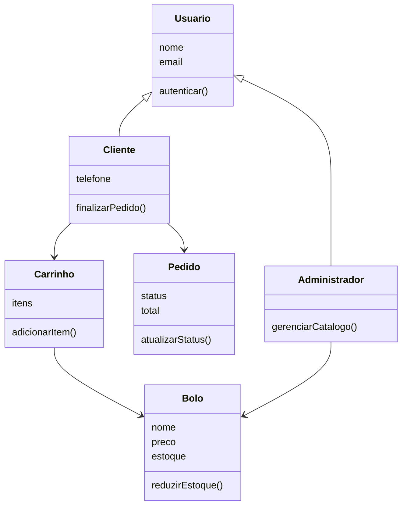
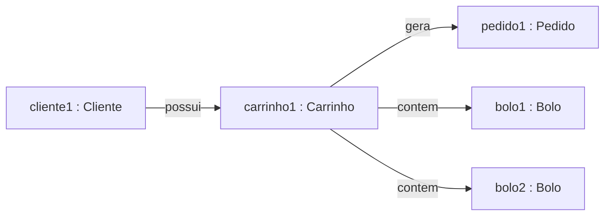

# Modelagem e Desenvolvimento Orientado a Objetos — Turma 86 VP

Repositório com as atividades da disciplina.

| Atividade | Tema | Onde está |
|---|---|---|
| Atividade I | Modelagem OO do projeto A&L Cakes | README abaixo |
| Atividade II | Modelagem e implementação OO da Loja ComprAqui | [`atividade-2-comprraqui/`](./atividade-2-comprraqui) |

---

# 🎂 Atividade I — Modelagem OO do projeto A&L Cakes

> Turma 86 — VP · Modelagem e Desenvolvimento Orientado a Objetos

## Contexto do projeto

O [A&L Cakes](https://github.com/iDneris/AL-Cakes-FullStack) é um sistema de e-commerce para uma
confeitaria artesanal, com backend em Node.js + TypeScript e banco de dados no Supabase
(PostgreSQL). Ele permite que o cliente monte um carrinho de bolos, finalize o pedido e acompanhe
o status, além de um painel administrativo para gerenciar o catálogo. É sobre esse domínio que a
modelagem abaixo foi construída.

---

## Diagrama de classes



---

## Diagrama de objetos



---

## 1. As 3 classes escolhidas

| Classe | Atributos | Operações |
|---|---|---|
| `Bolo` | `id`, `nome`, `preco`, `estoque` | `reduzirEstoque(qtd)`, `estaDisponivel(qtd)` |
| `Carrinho` | `id`, `itens` | `adicionarItem(bolo, qtd)`, `calcularTotal()` |
| `Pedido` | `id`, `status`, `total` | `atualizarStatus(novoStatus)`, `gerarMensagemWhatsApp()` |

**Justificativa:** escolhi `Bolo`, `Carrinho` e `Pedido` porque são as três entidades centrais do
domínio de e-commerce da aplicação: representam, respectivamente, o produto vendido, a estrutura
que agrupa os itens antes da compra e o registro formal da transação. Cada uma tem estado próprio
e comportamento que a diferencia de um simples "saco de dados" — o `Bolo` sabe controlar seu
próprio estoque, o `Carrinho` sabe calcular seu total, e o `Pedido` sabe validar suas próprias
transições de status.

---

## 2. Mensagem entre dois objetos

```
carrinho1.adicionarItem(bolo1, 2)
```

**Justificativa:** escolhi essa mensagem porque representa bem o conceito de troca de mensagens
entre objetos: o `Carrinho` não acessa nem manipula diretamente os dados internos do `Bolo` — ele
apenas envia uma solicitação, e é o próprio `Bolo` quem decide, através do seu método
`estaDisponivel()`, se a operação pode ou não ser realizada. Ou seja, cada objeto mantém a
responsabilidade sobre o seu próprio estado, e a comunicação entre eles acontece exclusivamente
por mensagens, sem que um objeto interfira diretamente na estrutura interna do outro.

---

## 3. Os quatro pilares no projeto

| Pilar | No A&L Cakes |
|---|---|
| **Abstração** | `Bolo` esconde a consulta ao Supabase atrás de `reduzirEstoque()` |
| **Encapsulamento** | `estoque` só muda via `reduzirEstoque()`, que valida antes de alterar |
| **Herança** | `Cliente`/`Administrador` **são um** `Usuario` |
| **Polimorfismo** | a checagem de permissão se comporta diferente para `Cliente` e `Administrador` |

**Justificativa de cada pilar:**

- **Abstração:** apliquei esse pilar na classe `Bolo`, através do método `reduzirEstoque()`. Ele
  expõe apenas a operação que o restante do sistema precisa conhecer ("reduzir uma quantidade do
  estoque"), sem revelar como essa alteração é feita internamente (consulta ao banco de dados,
  verificação de regras de negócio como `sob_encomenda`). Isso simplifica a interação com o
  objeto e reduz o acoplamento entre as classes.

- **Encapsulamento:** identifiquei esse pilar no atributo `estoque`, que não pode ser alterado
  diretamente por nenhuma outra classe. Toda modificação passa obrigatoriamente pelo método
  `reduzirEstoque()`, que valida a operação antes de efetivá-la. Dessa forma, protejo o dado
  contra estados inconsistentes, como um estoque negativo.

- **Herança:** representei esse pilar na relação entre `Usuario` e suas especializações,
  `Cliente` e `Administrador`. Ambos compartilham os atributos básicos definidos na superclasse
  (`id`, `nome`, `email`), evitando duplicação de código e reforçando a relação de
  generalização/especialização ("é um") entre as classes.

- **Polimorfismo:** apliquei esse pilar na forma como o sistema trata a verificação de
  permissões: a mesma ação se comporta de maneira diferente dependendo do tipo concreto do
  objeto que a executa — um `Administrador` tem acesso a operações de gerenciamento que um
  `Cliente` não possui. Isso evita a necessidade de estruturas condicionais para diferenciar o
  comportamento por tipo de usuário.
