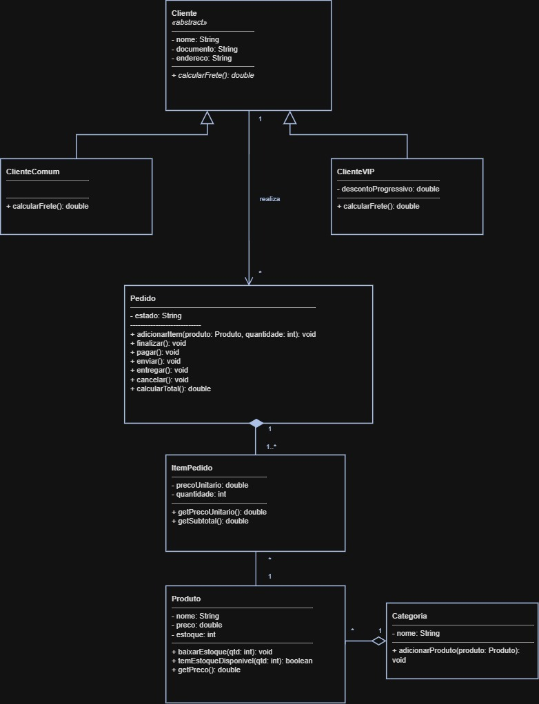

# 🛒 Atividade II — Modelagem e implementação OO da Loja ComprAqui

> Turma 86 — VP · Modelagem e Desenvolvimento Orientado a Objetos

Implementação em Java do diagrama de classes da entrevista técnica
(Cliente, ClienteComum, ClienteVIP, Pedido, ItemPedido, Produto, Categoria).

Exercício do curso de Orientação a Objetos (material BTS SIO): modelagem
de um diagrama de classes UML a partir de uma conversa cliente/desenvolvedor,
seguida da implementação em Java aplicando os quatro pilares de OO.

## Diagrama de classes



## Estrutura do projeto

```
comprraqui/
├── docs/
│   └── diagrama-classes.jpeg
└── src/
    └── comprraqui/
        ├── Main.java
        └── model/
            ├── Cliente.java        (abstract)
            ├── ClienteComum.java
            ├── ClienteVIP.java
            ├── Pedido.java
            ├── ItemPedido.java
            ├── Produto.java
            └── Categoria.java
```

## Como compilar e rodar

```bash
cd src
javac comprraqui/model/*.java comprraqui/Main.java
java comprraqui.Main
```

## Onde está cada requisito do enunciado

| Requisito | Onde está |
|---|---|
| Abstração | `Cliente` é `abstract`, só se instancia `ClienteComum`/`ClienteVIP` |
| Herança | `ClienteComum extends Cliente`, `ClienteVIP extends Cliente` |
| Polimorfismo | `calcularFrete()` (sem parametros) abstrato em `Cliente`, redefinido nas duas subclasses |
| Encapsulamento | Atributos privados/`final` em todas as classes; `Pedido.estado` só muda por método; `Produto.estoque` só muda por `baixarEstoque()`/`devolverEstoque()`; `ItemPedido.precoUnitario` é `final` (travado na criação) |
| Invariante "sem produto sem estoque" | `Pedido.pagar()` valida estoque de todos os itens antes de baixar qualquer um (tudo ou nada) |
| Associação | `Pedido` guarda uma referência a `Cliente` (1 cliente → * pedidos) |
| Agregação (◇) | `Categoria.produtos` — os `Produto` existem sozinhos no catálogo |
| Composição (◆) | `Pedido.itens` — os `ItemPedido` só existem dentro de um `Pedido`; `Pedido.adicionarItem(Produto, int)` cria o `ItemPedido` internamente, quem chama nunca instancia `ItemPedido` diretamente |

## Uma decisão de projeto que vale explicar ao professor

O enunciado lista `finalizar()` e `pagar()` como operações separadas.
Aqui, `finalizar()` "fecha o carrinho" (trava a lista de itens) e é em
`pagar()` que a regra crítica é aplicada: valida o estoque de todos os
itens e só então baixa o estoque e muda o estado para `"pago"`. Se
preferir, dá para fundir as duas em uma só operação — é só levar essa
verificação para dentro de `finalizar()`.

## Máquina de estados do Pedido

```
novo --finalizar()--> novo (trava itens)
novo --pagar()--> pago --enviar()--> enviado --entregar()--> entregue
novo/pago --cancelar()--> cancelado (devolve estoque se já estava pago)
```
